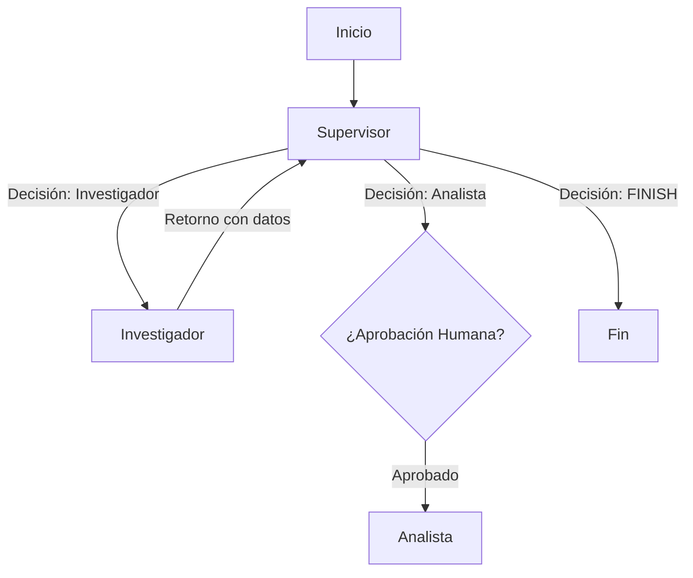
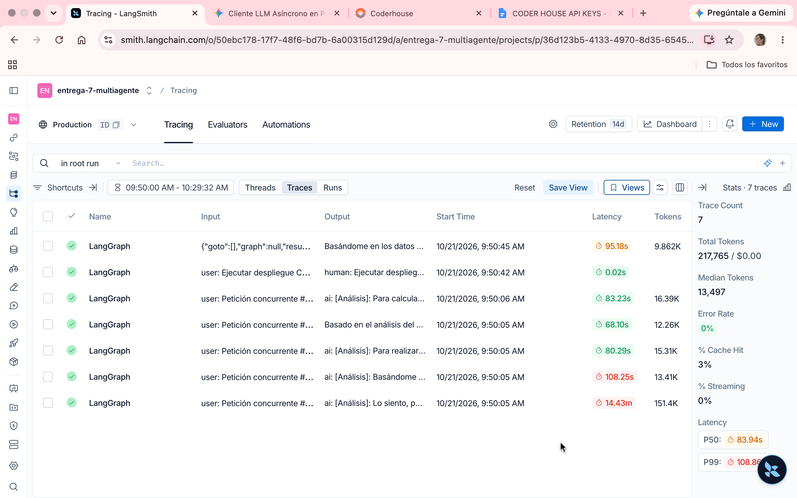
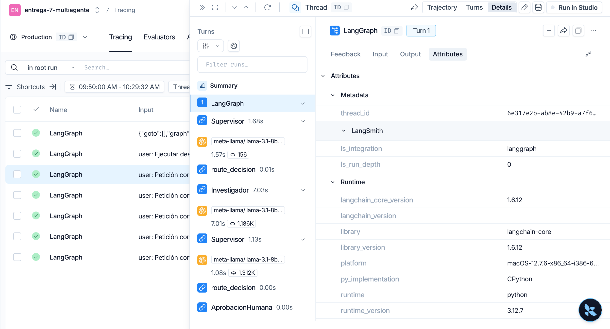
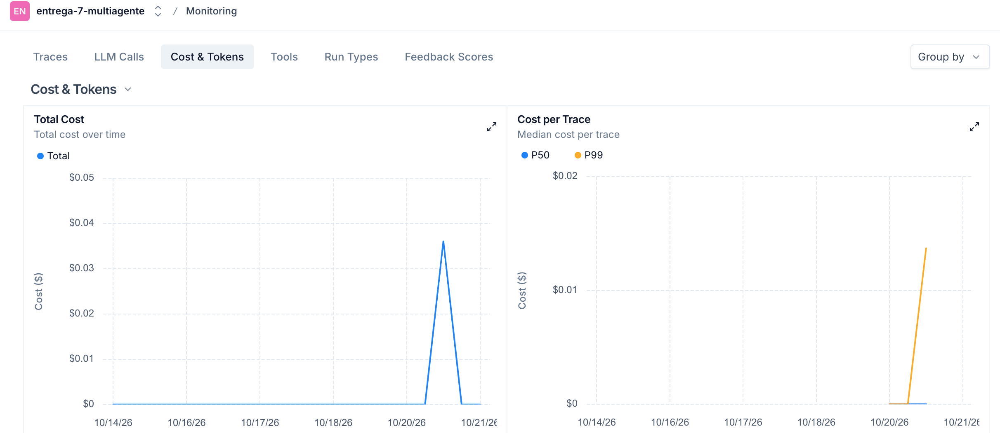

# Pre-entrega 7: API REST de Producción y Monitoreo Activo

Proyecto correspondiente a la Pre-entrega del curso de IA / Agentes de Coderhouse. Consiste en la evolución del Orquestador Multi-Agente Jerárquico hacia una API REST de producción asíncrona construida con FastAPI, persistencia de estado mediante checkpointing, capa de observabilidad activa con LangSmith y soporte de interacción Human-in-the-Loop (HITL).

---

## Consigna y Requerimientos de la Entrega

### Objetivo
Exponer el sistema multi-agente mediante una API REST asíncrona, desacoplando la recepción de peticiones de la ejecución del grafo, persistiendo el estado, instrumentando observabilidad activa y permitiendo la intervención humana en tareas críticas.

### Requerimientos Técnicos Cumplidos
* **Endpoints Asíncronos (No Bloqueantes):**
  * `POST /tasks`: Recibe la solicitud del usuario, la encola mediante `BackgroundTasks` y devuelve inmediatamente un `job_id`.
  * `GET /tasks/{job_id}`: Endpoint de sondeo (polling) para consultar el estado del trabajo sin bloquear el Event Loop (`RUNNING`, `WAITING_APPROVAL`, `DONE`).
  * `POST /tasks/{job_id}/approve`: Endpoint Human-in-the-Loop para reanudar ejecuciones pausadas.
* **Gestión de Estado y Checkpointing:**
  * Implementación de `MemorySaver` de LangGraph para persistir y recuperar hilos de ejecución por `thread_id`.
* **Observabilidad Activa:**
  * Instrumentación completa con **LangSmith** (`entrega-7-multiagente`).
  * Registro en tiempo real de trazas, latencia, consumo de tokens y tasa de errores por ejecución.
* **Human-in-the-Loop (HITL):**
  * Si la consulta del usuario es detectada como crítica (ej. despliegues en producción), el grafo se detiene en el nodo `AprobacionHumana` mediante `interrupt()`. Espera la aprobación explícita del operador para continuar hacia el nodo analista.
* **Prueba de Carga Concurrente:**
  * Scripts automatizados `test_concurrent.py` para lanzar peticiones simultáneas contra la API y `test_hitl.py` para validar el flujo de interrupción.

---

##  Diagrama del Grafo con HITL



## 📂 Estructura del Repositorio

```text
multiagent-orchestrator-api/
├── app/
│   ├── __init__.py
│   ├── config.py          # Configuración del LLM (OpenRouter)
│   ├── graph.py           # Definición del StateGraph, nodos y enrutamiento
│   ├── hitl.py            # Nodo de interrupción y aprobación humana
│   ├── main.py            # Endpoints de FastAPI y BackgroundTasks
│   └── state.py           # Esquema del TeamState (TypedDict)
├── env/                   # Entorno virtual de Python
├── screenshots/           # Capturas del dashboard de trazas y observabilidad
├── test_concurrent.py     # Script para lanzar peticiones concurrentes
├── test_hitl.py           # Script para probar el flujo HITL
├── requirements.txt       # Dependencias del proyecto
└── README.md              # Documentación
```
## Evidencias y Capturas

### Trazas y Monitoreo en LangSmith


### Trazas de Ejecución del Grafo


### Métricas de Costos y Tokens


## ⚙️ Pasos a Seguir

### 1. Configuración Inicial
Crea un archivo llamado `.env` en la raíz del proyecto y configura tus credenciales basándote en la siguiente estructura:
```env
OPENROUTER_API_KEY=tu_clave_de_openrouter
LANGSMITH_TRACING=true
LANGSMITH_ENDPOINT=[https://api.smith.langchain.com](https://api.smith.langchain.com)
LANGSMITH_API_KEY=tu_clave_de_langsmith
LANGSMITH_PROJECT=entrega-7-multiagente
```

### 2. Configuración del Entorno Virtual e Instalación
Abre una terminal en la carpeta del proyecto y ejecuta los siguientes comandos para preparar tu entorno:
```
python -m venv env
source env/bin/activate
pip install -r requirements.txt
```
### 3. Iniciar la API FastAPI
```
python -m uvicorn app.main:app --reload
http://127.0.0.1:8000
http://127.0.0.1:8000/docs
```

### 4. Ejecución de las Pruebas Automatizadas
Lanzar la prueba concurrente (múltiples solicitudes simultáneas):
```
python test_concurrent.py
```

Lanzar la prueba del flujo HITL (Aprobación humana):
```
python test_hitl.py
```


